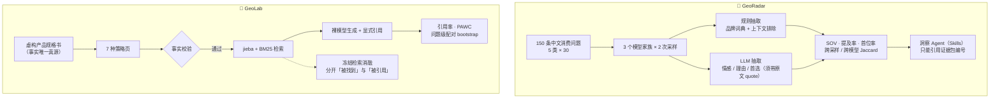

<div align="center">

# 📡 GeoRadar & 🧪 GeoLab

**面向 GEO（生成式引擎优化）/ 增长投放的两个 Agent 项目**

*Measure brand visibility inside AI answers, and test which content strategies actually get cited — with evidence, not vibes.*


</div>

> [!NOTE]
> 个人求职作品（方向：抖音 AI Agent 产品 · 增长投放），**不是**字节跳动、抖音或豆包的生产系统，与上述公司无官方关联，没有使用这些产品的真实流量或内部数据。

**产品观：** 能用规则和检索算死的，不交给模型吹；模型只做规则写不死的判断和假设，并且每条结论必须带可复核的证据。**监测不是因果，模拟不是线上流量。**

---

## 📑 目录

- [两个项目](#-两个项目)
- [背景与需求判断](#-背景与需求判断)
- [架构](#-架构)
- [实测结果](#-实测结果)
- [快速开始](#-快速开始)
- [目录结构](#-目录结构)
- [设计取舍](#-设计取舍)
- [诚实边界](#-诚实边界)
- [路线图](#-路线图)
- [FAQ](#-faq)
- [License](#-license)

---

## 🧭 两个项目

| 项目 | 一句话 | 产出 |
|---|---|---|
| 📡 **GeoRadar** | 品牌可见度监测与归因：把多模型、多次采样的回答变成可比较的指标 | SOV、提及率、首位率、来源类型、跨采样稳定性 + 带证据的机会与待验证假设 |
| 🧪 **GeoLab** | 内容策略对照实验台：在虚构品牌的受控语料上检验哪种内容写法更容易被引用 | 统计 / 引用 / 引言 / 结构化 FAQ / 时效 / 关键词堆砌（负向对照）的配对效应 |

## 🧩 背景与需求判断

| | |
|---|---|
| **场景** | 商家想知道「AI 回答里有没有我」「改内容能不能被 AI 引用」 |
| **用户痛点** | 商家普遍**无法验证** AI 推荐效果；市面上堆关键词、伪造背书等做法泛滥 |
| **判断** | 单次提问不可信 → **多模型 × 多次采样监测**；内容策略要用**配对对照实验**而不是案例 |
| **成本** | 全部开发估算 **¥9.62**；进程级费用上限 28 元；磁盘缓存中断续跑不重复计费 |
| **安全边界** | 生成内容禁止编造奖项、认证或规格书没有的数字，策略页必须先过事实校验；关键词堆砌只作负向对照 |

**二手调研（2026-11-17）**：5 篇公开报道中的 10 条商家 / 行业样本（**二手调研，缺少平台侧视角**），见 [docs/research/调研报告.md](docs/research/调研报告.md)。

## 🏗️ 架构



## 📊 实测结果

> 数字全部来自脚本，细节、区间和坏例以 `eval/` 为准。费用为按价格页标价的**估算**，不是账单。

### 📡 GeoRadar（150 题 × 3 模型 × 2 次采样 = 900 条回答，全部成功）

| 指标 | 数值 |
|---|---|
| 自发提及率（排除问题已含品牌的 720 条） | **0.6153** |
| 跨采样品牌集合 Jaccard / 首位一致率（360 对） | **0.6054** / **0.6167** |
| 跨模型 Jaccard | 约 0.50–0.62 |
| 前三品牌 SOV | 索尼 0.0701 · Bose 0.0546 · 携程 0.0516 |
| 分品类 SOV | 耳机·索尼 0.2669 · 咖啡·星巴克 0.2349 · 新能源车·比亚迪 0.1981 |
| 含 URL 的回答 | 0 / 900 |
| 规则层 vs LLM 抽取一致性（Jaccard） | 0.8985（两套自动抽取的一致性，**金标未经人工审阅，不是准确率**） |

### 🧪 GeoLab（40 题 × 7 策略 × 2 模型 × 3 种子 = 1,680 条 + 280 条冻结检索消融）

| 策略（相对基线，问题级配对 95% 区间） | 引用率 Δ | 结论 |
|---|---|---|
| `structured_faq` | **+0.2917** [0.1333, 0.4583] | 唯一显著优于基线；PAWC Δ +0.0966 |
| `keyword_stuffing`（负向对照） | **−0.2250** [−0.4125, −0.0208] | 26/40 题排名更差，与论文方向一致 |
| `statistics` / `cite_sources` / `quotation` / `freshness` | 显著为负 | — |
| 测试集 10 题（Agent 选策略） | +0.3667 [0.0333, 0.7000] | 与「全局最优」相同，**不能**说 Agent 学会按类型分配 |

> [!TIP]
> **关键洞察：** FAQ 的平均 BM25 排名从 3.45 提到 1.38；进入 top-k 后七种策略的条件引用率都在 0.93–1.00；冻结检索后所有策略 CI 都含 0。→ FAQ 的优势**几乎全部来自检索**，不是生成阶段更「会写」。

## 🚀 快速开始

```bash
git clone https://github.com/felix6328/douyin-geo-radar.git && cd douyin-geo-radar
python3 -m venv .venv && source .venv/bin/activate
pip install -r requirements.txt
export PYTHONPATH=$PWD

python -m pytest tests/ -q              # 18 个单元测试，不调用模型
python scripts/render_geolab.py         # 从已保存的回答重出 GeoLab 报告，不调 API
./scripts/run_app.sh                    # 工作台 → http://127.0.0.1:8766
```

<details>
<summary><b>完整复跑（需要 SILICONFLOW_API_KEY，会产生费用）</b></summary>

```bash
echo "SILICONFLOW_API_KEY=" > .env.local && chmod 600 .env.local   # 填入你的 key；加载器只解析这一行
python scripts/run_georadar.py          # 150 × 3 × 2，再做抽取、指标、洞察
python scripts/run_geolab.py            # 40 × 7 × 2 × 3 + 冻结检索消融
python scripts/write_cost.py            # 核对 docs/COST.md 与费用日志
```

费用上限默认 28 元（`configs/settings.yaml` 的 `api.spend_cap_cny`）。磁盘缓存 `data/cache/` 不入库；在有缓存的环境中，离线复跑请加 `--skip-llm-extract --skip-insight`，避免把需要 Key 的两节写成空结果。

</details>

## 🗂️ 目录结构

```text
douyin-geo-radar/
├── georadar/            # 监测：生成、品牌抽取、来源、指标、洞察 Agent
├── geolab/              # 实验：语料、事实校验、检索、生成、PAWC、统计、报告
├── geo_common/          # 共享：只读一行 key 的加载器、LLM 客户端、脱敏、路径
├── configs/             # 模型与费用上限、品牌词典、查询集、虚构规格书、Skills
├── data/                # 已保存的回答、抽取金标草稿、洞察（缓存 / 费用日志不入库）
├── eval/                # 结果与坏例报告
├── scripts/             # 运行、重出报告、费用核对、启动工作台
├── tests/               # pytest：抽取边界、事实校验、PAWC、检索、报告
├── app/                 # FastAPI 工作台
└── docs/                # PRD · DEMO · COST · 调研
```

<details>
<summary><b>代码导读</b></summary>

| 文件 | 作用 | 取舍 |
|---|---|---|
| `configs/brands/dictionary.yaml` + `georadar/brands.py` | 品类品牌词典 | 泛化词（苹果、小米）需邻近上下文，并排除苹果醋、小米粥 |
| `georadar/generate.py` | 生成提示 | 明确要求「没有联网、不要编网址」 |
| `georadar/insights.py` + `configs/skills/` | 洞察 Agent | 只能引用证据包编号，校验失败的条目不得当结论 |
| `geolab/factcheck.py` | 事实校验 | 拒绝编造奖项、未申报数字、贬低竞品；先护栏后效果 |
| `geolab/retrieve.py` | jieba + BM25 | 可控、可复现、不另付 embedding 费用；代价是 FAQ 可能靠词面重叠赢 |
| `geolab/pawc.py` | KDD 2024 公式 (3) | 只把显式 `[id]` 算作来源贡献，品牌名出现只进提及率 |
| `geolab/statsutil.py` | 配对区间 | 比「两条边际 CI 是否重叠」更合适 |

</details>

## ⚖️ 设计取舍

| 选择 | 放弃 | 原因 |
|---|---|---|
| 裸模型 + 本地 BM25 模拟引擎 | 接入真实带搜索的 AI 应用 | 可控、可复现；代价是不能代表真实 App 流量 |
| `GLM-4.5-Air` 做抽取器 | `GLM-5.3-Flash` | 后者在该接口无法关闭思考链，单次时延数十秒 |
| 问题级配对 bootstrap | 边际 CI 比较 | 小样本下配对更有效 |
| 先事实校验再进实验 | 允许「编造权威感」的写法 | 不用伪造背书换引用 |

## ⚠️ 诚实边界

- GeoRadar 调用的是硅基流动上的**裸模型**（DeepSeek-V3.2、Qwen3.6-35B-A3B、GLM-4.5-Air），**没有实时搜索**，不能当成豆包、元宝、通义或抖音站内 AI 的品牌露出。
- GeoLab 的品牌「北屿 / 澄声 / 澜极 / 山海 / 拾音社」全部虚构；这是模拟生成式引擎，**不是**对真实 GEO 平台的投放。
- 查询集和抽取金标由脚本起草，**未经人工审阅**；审阅前抽取器数字不能当准确率。
- 洞察 Agent 有 3 条引用校验未通过，报告中已标明，不当结论。
- 策略形态参考 Aggarwal et al., *GEO: Generative Engine Optimization*, KDD 2024（[DOI](https://doi.org/10.1145/3637528.3671900) · [arXiv](https://arxiv.org/abs/2311.09735)）。

## 🛣️ 路线图

- [x] GeoRadar：多模型多采样监测 + 指标 + 洞察 Agent
- [x] GeoLab：7 策略对照实验 + 冻结检索消融 + 训练 / 测试切分
- [x] 事实校验护栏与 18 个单元测试
- [ ] 人工审阅 150 条查询与抽取金标
- [ ] 换稠密检索验证 FAQ 优势是否来自词面重叠
- [ ] 接入带搜索的引擎做外部效度对照

## ❓ FAQ

<details>
<summary><b>能说「结构化 FAQ 在抖音 / 豆包上有效」吗？</b></summary>

不能。这是在本地 BM25 + 裸模型的模拟引擎上得到的结果，而且优势几乎全部来自检索阶段，不能当成普遍的 GEO 结论。
</details>

<details>
<summary><b>为什么关键词堆砌也在实验里？</b></summary>

作为负向对照：验证实验能测出「坏写法」。结果是引用率显著下降，与论文方向一致；生产环境不应采用。
</details>

<details>
<summary><b>PAWC 是什么？</b></summary>

Position-Adjusted Word Count：按句子词数和在回答中的位置加权，衡量某来源对回答的贡献。中文按 jieba 分词、去标点；多源共引时词数均分。
</details>

## 📄 License

代码以 [MIT](LICENSE) 协议开源，© 2026 felix6328。第三方说明见 [NOTICE](NOTICE)。
